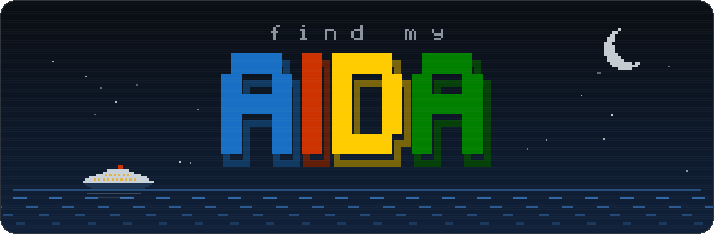
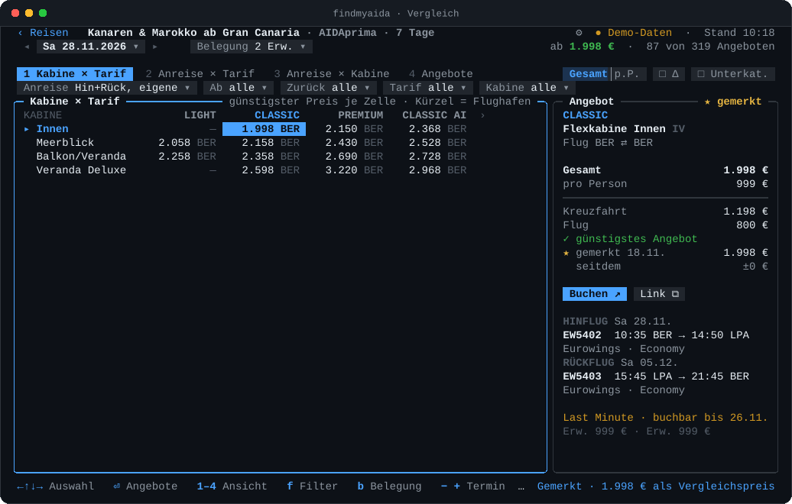
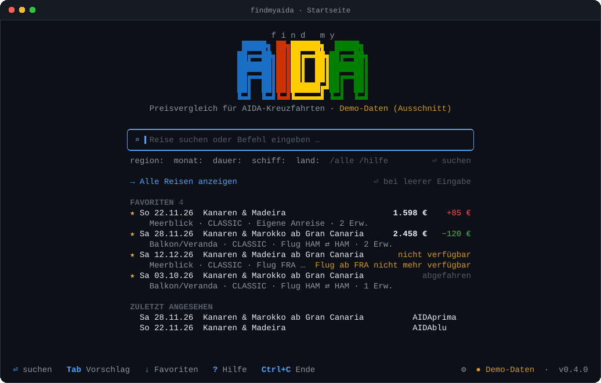
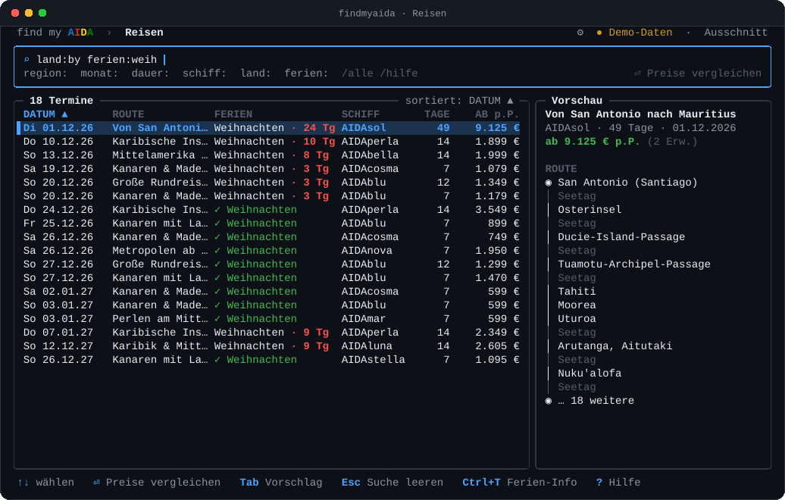
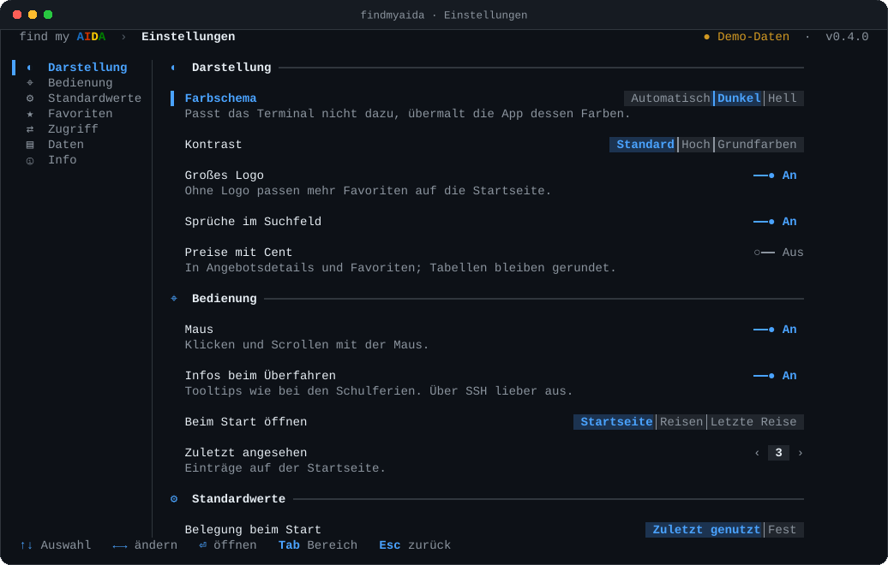

<!-- Graphics: .github/readme/, generated with `npm run readme` (scripts/readme-assets.ts) -->

<p align="center">
  <picture>
    <source media="(prefers-color-scheme: dark)" srcset=".github/readme/banner-dark.svg">
    <source media="(prefers-color-scheme: light)" srcset=".github/readme/banner-light.svg">
    
  </picture>
</p>

<h3 align="center">Every booking option of an AIDA cruise – compared in your terminal.</h3>

<p align="center">
  Cabins · fares · occupancy · flights from every airport – with the prices from AIDA's own booking process.
</p>

<p align="center">
  <a href="https://github.com/hallohallo12345674/findmyaida/releases/latest"></a>&nbsp;
  <a href="MANUAL.md"></a>&nbsp;
  <a href="https://github.com/hallohallo12345674/findmyaida/releases"></a>
</p>

<p align="center">
  &nbsp;
  &nbsp;
  
</p>

<p align="center">
  <a href="README.md"></a>
  <a href="README.en.md"></a>
</p>

<br>

<picture>
  <source media="(prefers-color-scheme: dark)" srcset=".github/readme/screen-compare-dark.svg">
  <source media="(prefers-color-scheme: light)" srcset=".github/readme/screen-compare-light.svg">
  
</picture>

## Features

<table>
  <tr>
    <td width="33%" valign="top">
      <br>
      <b>Every option at a glance</b><br>
      Cabin × fare, travel × fare, travel × cabin or every single offer – for up to four people.
    </td>
    <td width="33%" valign="top">
      <br>
      <b>Prices from the booking process</b><br>
      The same pricing engine as AIDA's booking assistant, including flights from every airport.
    </td>
    <td width="33%" valign="top">
      <br>
      <b>Favorites with price watch</b><br>
      Save an offer; the start screen shows how much its price has gone up or down since.
    </td>
  </tr>
  <tr>
    <td width="33%" valign="top">
      <br>
      <b>German school holidays</b><br>
      <code>land:by ferien:sommer</code> finds matching cruises for all 16 states and counts missed school days.
    </td>
    <td width="33%" valign="top">
      <br>
      <b>Mouse, keyboard, light and dark</b><br>
      Click, scroll, use shortcuts – and 20 settings on a single page.
    </td>
    <td width="33%" valign="top">
      <br>
      <b>No setup</b><br>
      One line installs everything including the Node runtime; start with a command or an icon.
    </td>
  </tr>
</table>

## Screenshots

<table>
  <tr>
    <td width="33%" align="center">
      <picture>
        <source media="(prefers-color-scheme: dark)" srcset=".github/readme/screen-home-dark.svg">
        <source media="(prefers-color-scheme: light)" srcset=".github/readme/screen-home-light.svg">
        
      </picture>
      <sub>Start screen with favorites</sub>
    </td>
    <td width="33%" align="center">
      <picture>
        <source media="(prefers-color-scheme: dark)" srcset=".github/readme/screen-trips-dark.svg">
        <source media="(prefers-color-scheme: light)" srcset=".github/readme/screen-trips-light.svg">
        
      </picture>
      <sub>Cruises in the Christmas holidays (Bavaria)</sub>
    </td>
    <td width="33%" align="center">
      <picture>
        <source media="(prefers-color-scheme: dark)" srcset=".github/readme/screen-settings-dark.svg">
        <source media="(prefers-color-scheme: light)" srcset=".github/readme/screen-settings-light.svg">
        
      </picture>
      <sub>Settings</sub>
    </td>
  </tr>
</table>

## Installation

One line, no admin rights, no Node.js required.

**macOS · Linux** (Terminal)

```bash
curl -fsSL https://github.com/hallohallo12345674/findmyaida/releases/latest/download/install.sh | sh
```

**Windows** (PowerShell)

```powershell
irm https://github.com/hallohallo12345674/findmyaida/releases/latest/download/install.ps1 | iex
```

## Usage

Start with `findmyaida` (short: `fma`) or via “FindMyAIDA” in Launchpad, the Start menu or your app menu.
To try it offline: `findmyaida --demo`. The app itself is in German.

| Key | Action |
|---|---|
| Type | search destination, port, ship or date, e.g. `kanaren monat:dez dauer:7` |
| `⏎` | open a cruise, or all offers of a cell |
| `1`–`4` | view: cabin × fare, travel × fare, travel × cabin, all offers |
| `m` | save offer ★ |
| `b` · `f` | occupancy · filters |
| `?` | all keys |

Update with `findmyaida update`, remove with `findmyaida uninstall`. Everything else is in the
**[manual](MANUAL.md)**.

## Project

- **Access:** directly from Node, falling back to a windowless Firefox or Chrome with the bundled extension. Nothing
  is disguised; the tool identifies itself by name.
- **Fair use:** at most one request at a time, at least 300 ms apart, with a cache; no bulk queries.
- **Development:** `npm install` · `npm run check` · `npm run dev -- --demo`
- **License:** [GPL-3.0](LICENSE) – use, modify and share it, modified too, under the same terms.

<br>

<p align="center">
  <sub>FindMyAIDA is an unofficial open-source project for personal use and is not affiliated with AIDA Cruises. “AIDA” and the colors of the logo letters belong to AIDA Cruises.</sub>
</p>
