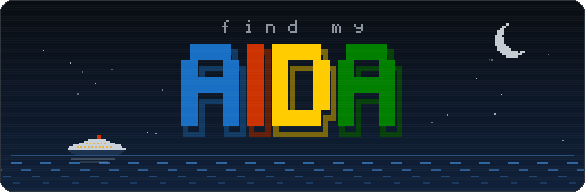
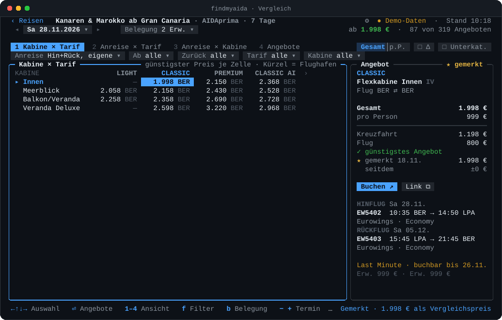
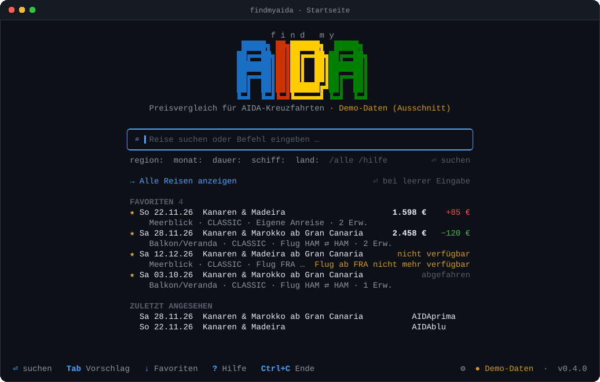
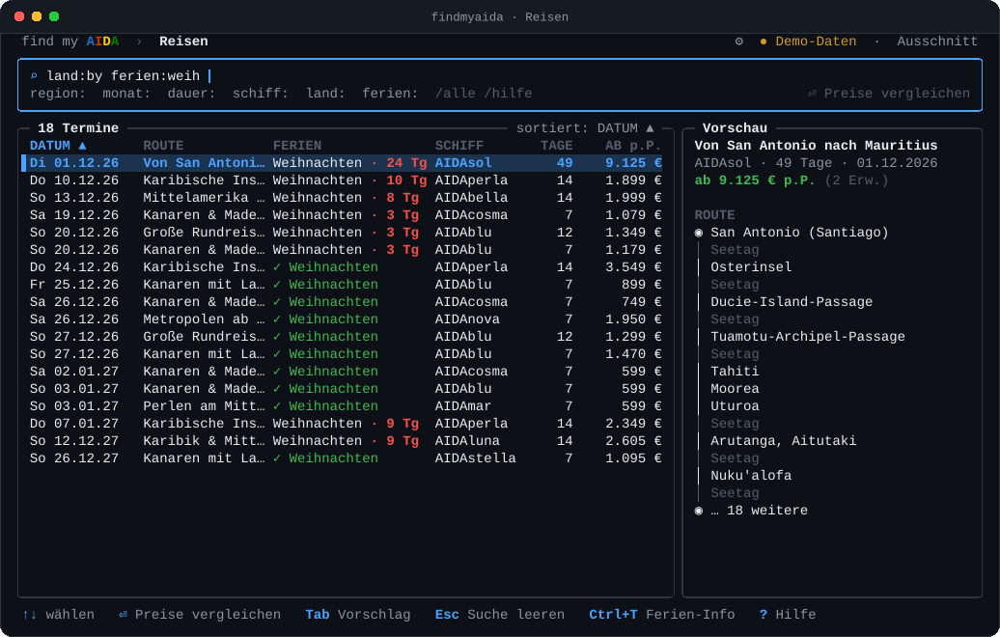
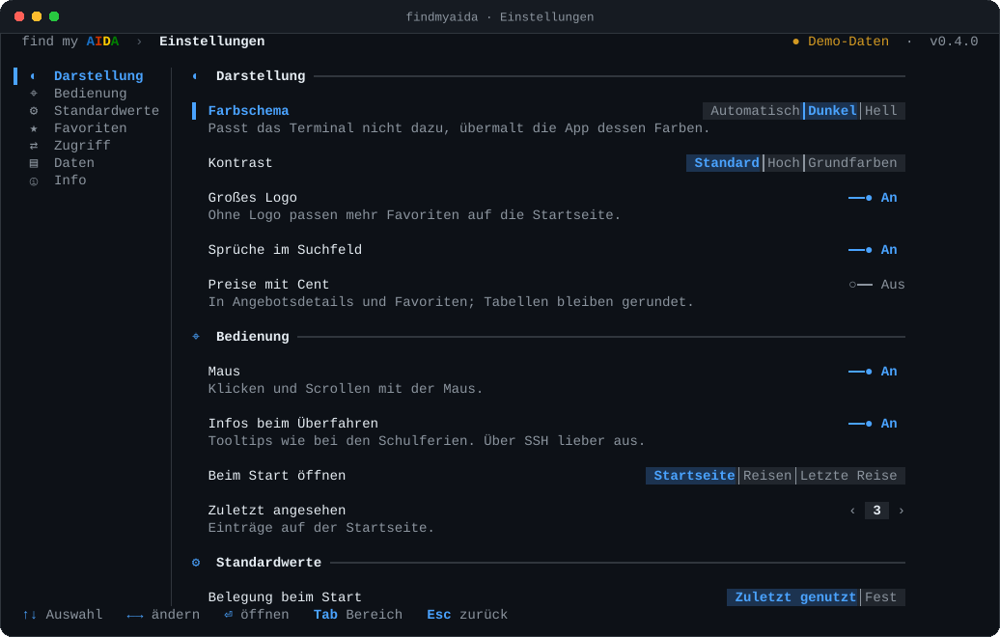

<!-- Grafiken: .github/readme/, erzeugt mit `npm run readme` (scripts/readme-assets.ts) -->

<p align="center">
  <picture>
    <source media="(prefers-color-scheme: dark)" srcset=".github/readme/banner-dark.svg">
    <source media="(prefers-color-scheme: light)" srcset=".github/readme/banner-light.svg">
    
  </picture>
</p>

<h3 align="center">Alle Buchungsoptionen einer AIDA-Kreuzfahrt – im Terminal verglichen.</h3>

<p align="center">
  Kabinen · Tarife · Belegung · Flüge ab allen Flughäfen – mit den Preisen aus dem AIDA-Buchungsprozess.
</p>

<p align="center">
  <a href="https://github.com/hallohallo12345674/findmyaida/releases/latest"></a>&nbsp;
  <a href="HANDBUCH.md"></a>&nbsp;
  <a href="https://github.com/hallohallo12345674/findmyaida/releases"></a>
</p>

<p align="center">
  &nbsp;
  &nbsp;
  
</p>

<p align="center">
  <a href="README.md"></a>
  <a href="README.en.md"></a>
</p>

<br>

<picture>
  <source media="(prefers-color-scheme: dark)" srcset=".github/readme/screen-compare-dark.svg">
  <source media="(prefers-color-scheme: light)" srcset=".github/readme/screen-compare-light.svg">
  
</picture>

## Funktionen

<table>
  <tr>
    <td width="33%" valign="top">
      <br>
      <b>Alle Optionen auf einen Blick</b><br>
      Kabine × Tarif, Anreise × Tarif, Anreise × Kabine oder jedes Einzelangebot – für bis zu vier Personen.
    </td>
    <td width="33%" valign="top">
      <br>
      <b>Preise aus dem Buchungsprozess</b><br>
      Dieselbe Preisengine wie der AIDA-Buchungsassistent, mit Flügen ab allen Flughäfen.
    </td>
    <td width="33%" valign="top">
      <br>
      <b>Favoriten mit Preisbeobachtung</b><br>
      Angebot merken; die Startseite zeigt, um wie viel der Preis seitdem gestiegen oder gefallen ist.
    </td>
  </tr>
  <tr>
    <td width="33%" valign="top">
      <br>
      <b>Schulferien aller 16 Länder</b><br>
      <code>land:by ferien:sommer</code> findet passende Reisen und zählt verpasste Schultage.
    </td>
    <td width="33%" valign="top">
      <br>
      <b>Maus, Tastatur, Hell und Dunkel</b><br>
      Klicken, scrollen, Tastenkürzel – und 20 Einstellungen auf einer Seite.
    </td>
    <td width="33%" valign="top">
      <br>
      <b>Ohne Einrichtung</b><br>
      Ein Einzeiler installiert alles samt Node-Laufzeit; Start per Befehl oder Symbol.
    </td>
  </tr>
</table>

## Screenshots

<table>
  <tr>
    <td width="33%" align="center">
      <picture>
        <source media="(prefers-color-scheme: dark)" srcset=".github/readme/screen-home-dark.svg">
        <source media="(prefers-color-scheme: light)" srcset=".github/readme/screen-home-light.svg">
        
      </picture>
      <sub>Startseite mit Favoriten</sub>
    </td>
    <td width="33%" align="center">
      <picture>
        <source media="(prefers-color-scheme: dark)" srcset=".github/readme/screen-trips-dark.svg">
        <source media="(prefers-color-scheme: light)" srcset=".github/readme/screen-trips-light.svg">
        
      </picture>
      <sub>Reisen in den Weihnachtsferien (Bayern)</sub>
    </td>
    <td width="33%" align="center">
      <picture>
        <source media="(prefers-color-scheme: dark)" srcset=".github/readme/screen-settings-dark.svg">
        <source media="(prefers-color-scheme: light)" srcset=".github/readme/screen-settings-light.svg">
        
      </picture>
      <sub>Einstellungen</sub>
    </td>
  </tr>
</table>

## Installation

Eine Zeile, ohne Admin-Rechte und ohne vorinstalliertes Node.js.

**macOS · Linux** (Terminal)

```bash
curl -fsSL https://github.com/hallohallo12345674/findmyaida/releases/latest/download/install.sh | sh
```

**Windows** (PowerShell)

```powershell
irm https://github.com/hallohallo12345674/findmyaida/releases/latest/download/install.ps1 | iex
```

## Nutzung

Starten mit `findmyaida` (kurz `fma`) oder über „FindMyAIDA“ in Launchpad, Startmenü bzw. App-Menü.
Zum Ausprobieren ohne Internet: `findmyaida --demo`.

| Taste | Funktion |
|---|---|
| Tippen | Ziel, Hafen, Schiff oder Datum suchen, z. B. `kanaren monat:dez dauer:7` |
| `⏎` | Reise öffnen bzw. alle Angebote einer Zelle |
| `1`–`4` | Ansicht: Kabine × Tarif, Anreise × Tarif, Anreise × Kabine, alle Angebote |
| `m` | Angebot merken ★ |
| `b` · `f` | Belegung · Filter |
| `?` | alle Tasten |

Aktualisieren mit `findmyaida update`, entfernen mit `findmyaida uninstall`. Alles Weitere im
**[Handbuch](HANDBUCH.md)**.

## Projekt

- **Zugriff:** direkt aus Node, ersatzweise über Firefox ohne Fenster oder Chrome mit Erweiterung. Kein Weg wird
  getarnt; das Werkzeug nennt sich beim Namen.
- **Fair Use:** höchstens eine Anfrage gleichzeitig, mindestens 300 ms Abstand, Cache; keine Massenabfragen.
- **Entwicklung:** `npm install` · `npm run check` · `npm run dev -- --demo`
- **Lizenz:** [GPL-3.0](LICENSE) – nutzen, ändern und weitergeben, auch verändert, unter denselben Bedingungen.

<br>

<p align="center">
  <sub>FindMyAIDA ist ein inoffizielles Open-Source-Projekt für den persönlichen Gebrauch und steht in keiner Verbindung zu AIDA Cruises. „AIDA“ und die Farben der Logobuchstaben gehören AIDA Cruises.</sub>
</p>
